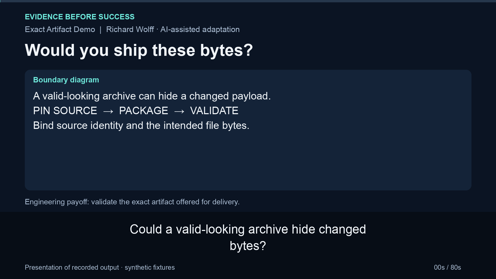

# Exact artifact demo

Verify the exact bytes offered for delivery before anything is activated. This small, source-derived example packages one synthetic HTML page from a clean Git commit and rejects mismatched source identity, altered payloads, unexpected files and invalid CI-context records.

**The trust boundary:** hashes and supplied evidence check consistency against independently trusted expectations. They are not signatures or proof that a CI run succeeded. If an attacker controls the artifact, evidence and every expected input, they can forge agreement. One test deliberately demonstrates that limit.

## 80-second walkthrough

[**Watch or download the captioned walkthrough (MP4)**](docs/walkthrough/walkthrough.mp4)

[](docs/walkthrough/walkthrough.mp4)

Watch immutable-source packaging and payload rejection after the enclosing archive hash is re-pinned.

[Transcript](docs/walkthrough/transcript.txt) · [Captions](docs/walkthrough/captions.srt) · [Reproduce the recorded behavior](docs/walkthrough/reproduce.sh) · [Context and source revision](docs/walkthrough/README.md)

The video presents recorded output from synthetic fixtures, with neutral synthetic narration. Its pinned source revision is recorded alongside the video.

## Try it

Requires Python 3.11+ and Git. No dependencies, containers, accounts or credentials.

```sh
git clone https://github.com/wolffrichardj/exact-artifact-demo.git
cd exact-artifact-demo
python3 -m unittest discover -s tests -v
python3 demo.py
```

The demo requires a clean committed checkout. It creates temporary files outside it, verifies a good artifact, then substitutes payload bytes while updating the outer archive hash in both synthetic evidence and the test expectation. The unchanged per-file manifest causes `PAYLOAD_HASH_MISMATCH`. Temporary files are removed when it finishes. CI runs these same checks without deployment.

To keep an artifact for inspection, choose an empty directory outside the checkout:

```sh
python3 release.py package . /tmp/exact-artifact-output \
  --repository example/sample --workflow synthetic-local --run-id 1 --attempt 1
python3 release.py validate --help
```

Packaging prints paths and identity/digest values. `validate` requires explicit `--repository`, `--workflow`, `--revision`, `--tree`, `--run-id`, `--attempt`, `--expected-sha` and `--expected-manifest` arguments in addition to archive/evidence paths. A real caller must obtain those expectations through its trusted pipeline. Copying them from an untrusted package only establishes self-consistency. The demo uses local synthetic expectations and makes no external CI provenance claim.

## What is checked

| Boundary | Required behavior |
| --- | --- |
| Source | Clean Git root; captured full commit/tree; bytes, modes and inventory read from that immutable commit |
| Package | Exactly `public/index.html`, `RELEASE.json`, `MANIFEST.sha256`; stable archive metadata |
| Context | Exact repository, workflow name, commit/tree, run/attempt, push to main and successful conclusion |
| Bytes | Independently expected archive and manifest SHA-256; each payload digest and exact manifest membership |
| Structure | Canonical paths, regular files only, no duplicates, links, extension records, hidden trailing members or missing entries |
| Local bounds | At most 1 MiB compressed and expanded; in-memory inspection without extraction |

Failures return nonzero with a stable diagnostic category. Tests re-pin enclosing hashes to reach inner checks. The payload-tampering test also disables the per-file comparison temporarily and confirms that the corrupted fixture would then be admitted, demonstrating that the test detects a missing protection.

## Where it came from

Adapted from private website release tooling developed in September and October 2026. The original split CI artifact identity checks from host-side payload verification. This sample retains actual helpers and adapts those checks into one offline module. [NOTICE.md](NOTICE.md) identifies retained behavior, new hardening and exclusions.

This repository starts with the current adaptation. Whole historical commits mixed delivery code with private application and operational material; path filtering alone would retain those details in old versions. Original history and exact source mappings are retained privately. New work is not backdated.

This demonstrates packaging and validation only. There is no host activation, rollback rehearsal, SSH, SMTP, application runtime or production deployment claim. It is a small local engineering example, not a general-purpose archive service or CI attestation system. No adoption, performance gain or business outcome is claimed.

[MIT license](LICENSE) applies to this generalized sample.
